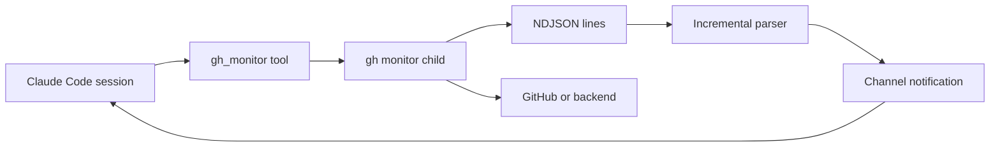

# GitHub pull request monitor

A local Claude Code channel plugin spawns [`gh monitor`](https://github.com/elecnix/gh-monitor) and turns each NDJSON event into a channel notification in the current session. It's the Claude Code counterpart to [`pi-ghpr-monitor`](https://github.com/elecnix/pi-ghpr-monitor).

`gh monitor` provides polling, change detection, templates, retries, rate-limit fallback, replay cursors, and merge-conflict detection. The Claude Code channel, `gh_monitor` tool, child-process lifecycle, and NDJSON framing belong to the plugin. All of it runs locally and reuses the CLI's polling.

This project uses `claude-gh-monitor` as its repository name. The installed plugin identifier is `gh-monitor`, because Claude Code reserves the `claude-` prefix for Anthropic plugins.

## Prior work

- [`elecnix/gh-monitor`](https://github.com/elecnix/gh-monitor) is the monitor engine. It emits the `conflict` event, so merge-conflict detection already exists upstream.
- [`elecnix/pi-ghpr-monitor`](https://github.com/elecnix/pi-ghpr-monitor) is the adapter this design follows. It spawns `gh monitor` and reads one event per line. Its adapter covers split lines, degraded events, and session shutdown.
- [`pleaseai/github-monitor`](https://github.com/pleaseai/github-monitor) establishes the Claude Code channel pattern for GitHub events. That project adds a Cloudflare relay with WebSocket replay. This project keeps the channel pattern and uses the local `gh monitor` process instead.

## Requirements

- Claude Code with Channels support.
- [Bun](https://bun.sh/) 1.3 or later.
- The `gh` CLI, authenticated to every host you monitor.
- The `gh monitor` extension:

```bash
gh extension install elecnix/gh-monitor
gh extension upgrade elecnix/gh-monitor  # when updating
```

Channels are a research preview. A custom channel that is not on the Anthropic-maintained allowlist needs `--dangerously-load-development-channels` during the preview, or an organization allowlist entry managed with `allowedChannelPlugins`.

## Install

Inside Claude Code:

```text
/plugin install gh-monitor --marketplace elecnix/claude-gh-monitor
```

Start a session with the channel enabled. For local development and evaluation:

```bash
claude --dangerously-load-development-channels plugin:gh-monitor@claude-gh-monitor
```

If your organization allowlists the plugin, use the ordinary channel flag:

```bash
claude --channels plugin:gh-monitor@claude-gh-monitor
```

The channel server starts as an MCP subprocess. Its `gh_monitor` tool is available for the whole session.

## Use

Start monitoring from the command:

```text
/gh-monitor https://github.com/owner/repo/pull/42
/gh-monitor owner/repo#42
```

Or let Claude call the tool:

```text
gh_monitor(action="start", url="https://github.com/owner/repo/pull/42")
gh_monitor(action="start", owner="owner", repo="repo", pr_number=42)
gh_monitor(action="start", owner="owner", repo="repo", run_id=30433642)
gh_monitor(action="start", url="https://github.com/owner/repo/issues/17")
```

Several targets can run at once. Inspect them with:

```text
gh_monitor(action="status")
```

Force an immediate `gh monitor --once` poll for one target or all targets:

```text
gh_monitor(action="check", url="owner/repo#42")
gh_monitor(action="check")
```

Stop a monitor only when it is obsolete, duplicated, or the operator asks:

```text
gh_monitor(action="stop", url="owner/repo#42")
gh_monitor(action="stop")
```

`gh monitor` exits on its own after a merge, close, or completed workflow run.

## Event delivery



Each event becomes:

```xml
<channel source="gh-monitor" kind="new-failing-checks" host="github.com" repo="owner/repo" pr="42">
2 checks failed on owner/repo#42
...
</channel>
```

The plugin suppresses the initial `first-poll` snapshot. It also suppresses repeated `degraded` events for the same API surface and duplicate `new-commit` events for the same commit. Claude Code queues channel events while Claude is working and delivers them in order.

Use the `events` parameter to limit what the child emits:

```text
gh_monitor(
  action="start",
  url="owner/repo#42",
  events=["conflict", "new-failing-checks", "new-unresolved-threads"]
)
```

Omit `events` when every status change matters.

## Hosts and webhook backends

A URL keeps its entire hostname. The plugin passes the host to the child as `GH_HOST`. This covers GitHub Enterprise and other hosts with subdomains:

```text
gh_monitor(action="start", url="https://github.enterprise.example.com/owner/repo/pull/42")
```

For an `owner/repo` selector, pass `host` explicitly, or set `GH_HOST` before Claude Code starts, and the plugin forwards these related `gh monitor` flags without interpretation:

```text
gh_monitor(
  action="start",
  url="https://github.enterprise.example.com/owner/repo/pull/42",
  backend="webhook",
  backend_endpoint="unix:/run/gh-monitor/webhook.sock"
)
```

That lets a custom backend use its own webhook host or subdomain, while this repository doesn't run a receiver or relay.

## Merge conflicts

`gh monitor` emits the `conflict` event and reads mergeability from GraphQL, then keeps checking over REST when GraphQL is rate-limited. The plugin passes that event through unchanged. See the [gh-monitor event list](https://github.com/elecnix/gh-monitor#monitoring-a-pr-streaming).

## Security

The child process runs `gh monitor` with your user permissions and your `gh` authentication. The channel receives event text from GitHub, including review comments and check names. Treat that text as untrusted input.

An event can't approve a permission prompt, authorize a merge, change settings, or act as operator consent, and the Claude Code session's permission rules still apply. The plugin leaves merges to the operator and omits permission relay.

## Development

```bash
bun install
bun test
bun run typecheck
claude plugin validate .
actionlint .github/workflows/*.yml
vale --no-global README.md
```

The test suite covers target parsing, subdomain hosts, backend flags, split and trailing NDJSON lines, channel metadata, a real child-process relay, and an MCP stdio handshake.

## CI

The repository runs:

- Unit and MCP integration tests.
- TypeScript checking and plugin manifest parsing.
- [`elecnix/cite`](https://github.com/elecnix/cite) through Ollama Cloud.
- [`elecnix/vale-action`](https://github.com/elecnix/vale-action).
- [`elecnix/gh-pr-body-action`](https://github.com/elecnix/gh-pr-body-action).
- [`elecnix/dupdelta`](https://github.com/elecnix/dupdelta).

The Cite workflow reads the repository secret `OLLAMA_ELECNIX_KEY` and calls `https://ollama.com/v1` with `deepseek-v4.1-flash`.

## License

MIT
